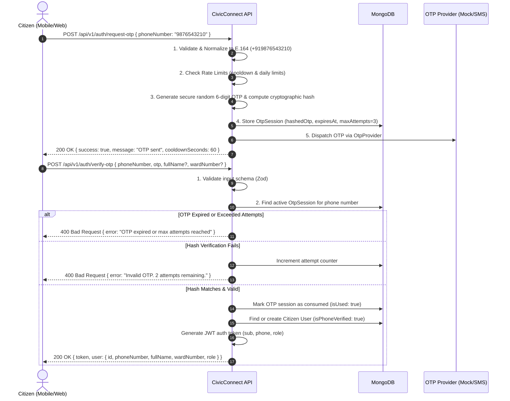

# CivicConnect: Citizen Signup & Mobile OTP Verification Design

## 1. Overview & Context

CivicConnect is a civic grievance reporting and management platform serving citizens in **Jammu, Jammu & Kashmir, India**.
Mobile number authentication via One-Time Password (OTP) is the primary onboarding flow for citizens, providing low friction, high adoption, and immediate verification of the citizen's primary communication channel.

---

## 2. Signup & Verification Flow



---

## 3. Detailed Step-by-Step Specifications

### Step 1: Citizen Mobile Input & Request
- **Endpoint**: `POST /api/v1/auth/request-otp`
- **Request Body**:
  ```json
  {
    "phoneNumber": "9419112345"
  }
  ```

### Step 2: Validation & Normalization
- Handled by `src/utils/phone.ts` and `src/modules/auth/auth.types.ts`:
  - Enforces Indian mobile numbering scheme: exactly 10 digits starting with `6`, `7`, `8`, or `9`.
  - Normalizes to canonical E.164: `+919419112345`.
  - Rejects foreign formats or invalid prefixes before any database or provider operations.

### Step 3: Rate Limiting & Cooldown Protection
- **Resend Cooldown**: A citizen cannot request a new OTP for the same phone number within `OTP_RESEND_COOLDOWN_SECONDS` (default: 60s).
- **IP Rate Limiting**: Maximum 10 OTP requests per hour per IP to prevent spam attacks.
- **Phone Rate Limiting**: Maximum 5 OTP requests per phone number per 24 hours to prevent SMS bill exhaustion and spam.

### Step 4: OTP Generation & Storage
- Cryptographically generated random 6-digit number using `crypto.randomInt(100000, 1000000)`.
- Never stored as plaintext in the database:
  - Stored as a salted SHA-256 or bcrypt hash (`hashedOtp`).
- Expiration: `expiresAt = Date.now() + 5 * 60 * 1000` (5 minutes).
- `maxAttempts`: 3 attempts.

### Step 5: Provider Abstraction for Delivery
- Abstracted via `OtpProvider` interface in `src/providers/otp/otpProvider.interface.ts`.
- **Development/Testing (`MockOtpProvider`)**:
  - Simulates delivery and stores generated message records in isolated memory.
  - Safe logging masks phone numbers (`+91******2345`).
  - Does NOT hardcode static universal OTPs like `123456`.
  - Exposes `getLastSentOtpForTest()` strictly restricted to non-production environments for automated integration tests.
- **Production SMS Gateway**:
  - Integration with CDAC (Govt SMS gateway), Fast2SMS, Twilio, or AWS SNS by implementing `OtpProvider`.

### Step 6: OTP Submission & Verification
- **Endpoint**: `POST /api/v1/auth/verify-otp`
- **Request Body**:
  ```json
  {
    "phoneNumber": "9419112345",
    "otp": "839201",
    "fullName": "Rohit Sharma",
    "wardNumber": 12
  }
  ```
- **Validation**:
  - Check if active session exists and is unexpired (`expiresAt > now`).
  - Check attempt count (`attempts < maxAttempts`). If attempts exceeded, invalidate the session.
  - Compare cryptographic hash. If mismatch, atomically increment `attempts`.
  - If match, mark session `isUsed = true`.

### Step 7: Citizen User Creation & JWT Issuance
- Find user by normalized `phoneNumber`:
  - If exists: update last login timestamp.
  - If not exists: create citizen record with `isPhoneVerified: true`, `role: 'citizen'`, and optional `wardNumber` (1-75 in Jammu Municipal Corporation).
- Issue standard signed JWT:
  ```json
  {
    "sub": "651a2f...",
    "phoneNumber": "+919419112345",
    "role": "citizen",
    "iat": 1718000000,
    "exp": 1718604800
  }
  ```

---

## 4. Database Schema Design (Mongoose)

### 1. `OtpSession` Schema
```ts
const otpSessionSchema = new Schema({
  phoneNumber: { type: String, required: true, index: true },
  hashedOtp: { type: String, required: true },
  attempts: { type: Number, default: 0 },
  maxAttempts: { type: Number, default: 3 },
  expiresAt: { type: Date, required: true, index: { expires: 0 } }, // MongoDB TTL auto-cleanup
  isUsed: { type: Boolean, default: false },
}, { timestamps: true });
```

### 2. `User` Schema
```ts
const userSchema = new Schema({
  phoneNumber: { type: String, required: true, unique: true, index: true },
  fullName: { type: String, trim: true },
  wardNumber: { type: Number, min: 1, max: 75 }, // JMC 75 wards
  role: { type: String, enum: ['citizen', 'official', 'admin'], default: 'citizen' },
  isPhoneVerified: { type: Boolean, default: false },
  lastLoginAt: { type: Date },
}, { timestamps: true });
```

---

## 5. Security Principles Implemented

1. **Production OTP Isolation & Mock Rejection**: Mock OTP provider is strictly prohibited in production. Server startup terminates immediately if `OTP_PROVIDER=mock`, `MockOtpProvider` constructor throws in production, and no silent fallback to mock is permitted when configuring external providers.
2. **Zero Hardcoded Secrets or Universal OTPs**: No universal `123456` or mock bypasses in production.
3. **Cryptographic JWT Secret Enforcement**: In production, `JWT_SECRET` must be non-empty, cannot match known placeholders, and must be at least 32 characters long. JWT secrets are never printed in logs.
4. **Never Return OTP in Response**: API responses confirm delivery initiation only; the OTP is never sent in HTTP response bodies or public logs.
5. **Cryptographic Protection**: Constant-time string comparison or secure hashing prevents timing attacks.
6. **Strict TTL & Atomicity**: MongoDB TTL indices automatically purge stale verification tokens.
7. **PII Masking**: Logs mask phone numbers (`+91******3210`) to comply with data privacy standards.
8. **Credential-Safe CORS**: Wildcard `*` origins are strictly decoupled from `credentials: true` to prevent browser security policy violations, with full support for explicit frontend origin allowlists.
